<div align="center">


# BOLADÃO

Construído em **Rust + Tauri 2 + React 19 + WebGL2**, com **yt-dlp**, **Deno** e **FFmpeg 9.0.2** empacotados num único executável, fila persistente em SQLite, limitador global de banda em tempo real com **Modo Jogo**, **Oficina FFmpeg**, biblioteca técnica com waveform/espectrograma e visual **Op-Art topográfico** interativo.

<p>
  
  
  
  
  
  <a href="LICENSE"></a>
</p>

<p>
  <a href="#-como-instalar-usuários"><strong>Baixar (Releases)</strong></a> &nbsp;·&nbsp;
  <a href="#-recursos-em-detalhes">Recursos</a> &nbsp;·&nbsp;
  <a href="#-4-temas-op-art-wcag-21-aa">Temas</a> &nbsp;·&nbsp;
  <a href="#-atalhos-de-teclado">Atalhos</a> &nbsp;·&nbsp;
  <a href="#-como-rodar-e-compilar-localmente">Rodar localmente</a> &nbsp;·&nbsp;
  <a href="#-arquitetura-e-segurança">Arquitetura</a>
</p>

<br />

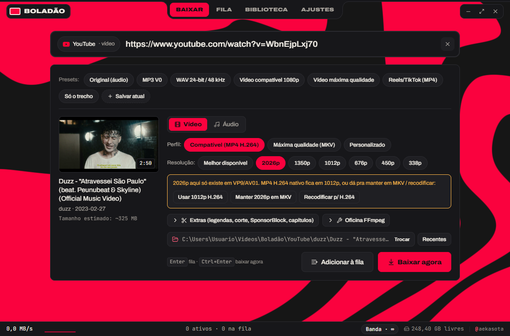

</div>

---

## Por que o Boladão?

Baixar mídia da internet no Windows geralmente significa escolher entre sites cheios de pop-ups suspeitos, interfaces datadas ou passar horas configurando Python, `PATH`, `ffmpeg` e flags crípticas no terminal.

O **Boladão** reúne o poder completo do `yt-dlp` + `FFmpeg` + `Deno` em um aplicativo nativo leve, bonito e honesto com o usuário:

- **Zero dependências externas** — `yt-dlp`, `Deno` e `FFmpeg/FFprobe 9.0.2 (full-shared)` vão compactados em `zstd` nível 19 dentro do executável (~132 MB) e são extraídos atomicamente na primeira abertura.
- **Feito para jogar sem lag** — Proxy HTTP/CONNECT local com **Token Bucket** global compartilhado por todos os downloads simultâneos (incluindo HLS/DASH) e **Modo Jogo** automático que limita a banda, reduz concorrência e congela o shader (`0% GPU`).
- **Oficina FFmpeg integrada** — Normalize volume em 2 passadas (`-14 / -16 / -23 LUFS`), converta para WAV 24-bit/48 kHz com reamostragem SoXR, comprima vídeos para caber no Discord/WhatsApp (`10 / 16 / 25 / 50 MB`), gere GIFs com paleta otimizada, recodifique na GPU (NVENC/QSV/AMF) ou transcreva áudio em `.srt` localmente com Whisper.cpp.
- **Biblioteca com análise técnica real** — Histórico persistente em SQLite com forma de onda (`showwavespic`), metadados completos do `ffprobe`, loudness em LUFS e espectrograma sob demanda com detector automático de corte em ~16 kHz.
- **100% local, transparente e seguro** — Sem telemetria, sem anúncios, sem invocar shell do Windows, sem processos órfãos ao fechar (Windows Job Objects) e com botão de 1 clique para copiar o comando `yt-dlp` equivalente.
- **Design Op-Art vivo e acessível** — Fundo WebGL2 responsivo ao cursor e à velocidade real da rede, com 4 temas validados matematicamente em contraste **WCAG 2.1 AA (`≥ 4,5:1`)** e modo *Reduzir movimento*.

---

## ✨ Recursos em detalhes

### 1. Sondagem inteligente, playlists e 1.600+ plataformas

- **Classificação instantânea (`< 1 ms`, sem rede)** para YouTube, YouTube Music, Instagram (Reels, Posts, Stories), TikTok, X/Twitter, Reddit, Twitch (VODs, Clipes, Lives), Vimeo, SoundCloud, Bandcamp, Facebook, Kick, Dailymotion, Bilibili — além de mais de **1.600 extratores** nativos do `yt-dlp`.
- **Bloqueio honesto de DRM** — Links de Spotify, Netflix, Disney+, Prime Video, Apple Music, Deezer e Tidal exibem um aviso direto sem desperdiçar tempo tentando sondar.
- **Links híbridos (`watch?v=...&list=...`)** — Escolha inline entre **Só este vídeo** (padrão) ou **Playlist inteira**, sem baixar dezenas de vídeos por engano.
- **Seletor completo de playlists** — Selecione por intervalo (`Do #` / `Até #`), filtre Shorts e lives, ative numeração (`01 - ...`), junte a playlist inteira (`--concat-playlist`) ou use `--download-archive` para nunca baixar duplicatas.
- **Aviso inteligente de compatibilidade** — Se você pedir 4K/1440p em *Compatível (MP4 H.264)* e o vídeo só existir em VP9/AV1, o app avisa na hora e oferece 1 clique para baixar em H.264 nativo, manter em `MKV` sem perda ou recodificar para H.264 via GPU.
- **7 presets nativos + presets personalizados** — *Original (áudio)*, *MP3 V0*, *WAV 24-bit / 48 kHz*, *Vídeo compatível 1080p*, *Vídeo máxima qualidade (MKV)*, *Reels/TikTok (MP4)* e *Só o trecho*. O app também lembra automaticamente sua última escolha por plataforma.
- **Extras de 1 clique** — SponsorBlock (remover ou marcar capítulos, incluindo atalho para remover partes sem música em clipes), legendas embutidas ou `.srt`, embutir/dividir capítulos, corte de trechos com slider duplo e corte preciso em keyframes, capa quadrada `1:1` automática e limpeza de sufixos (`(Official Video)`, `[4K]`, etc.).
- **Captura sem atrito** — Cole links de qualquer lugar (`Ctrl+V` global), arraste URLs direto para a janela ou extraia múltiplos links colados de mensagens do WhatsApp/Discord de uma só vez. Ao voltar para a janela com um link na área de transferência, uma pílula discreta de 6 segundos oferece colar.

<div align="center">
  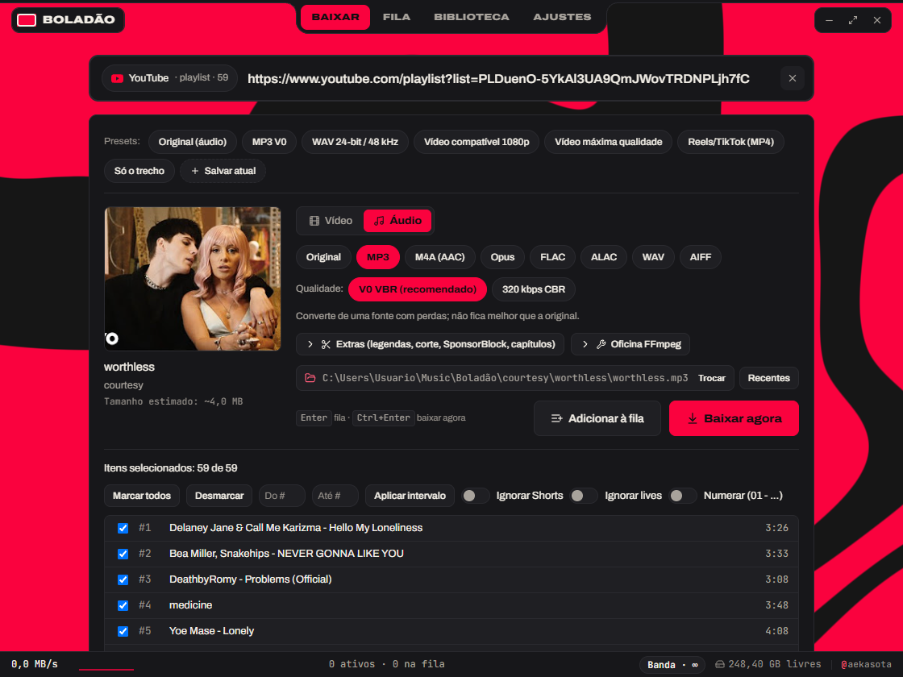
  <br /><br />
  
  <sub><i>Fluxo completo de playlist: colar URL → escolher formato (MP3 V0) → filtrar intervalo → baixar em grupo na fila.</i></sub>
</div>

---

### 2. Oficina FFmpeg embutida

Transforme qualquer download automaticamente ao final da fila — ou reprocesse arquivos já baixados diretamente pela **Biblioteca**:

<div align="center">
  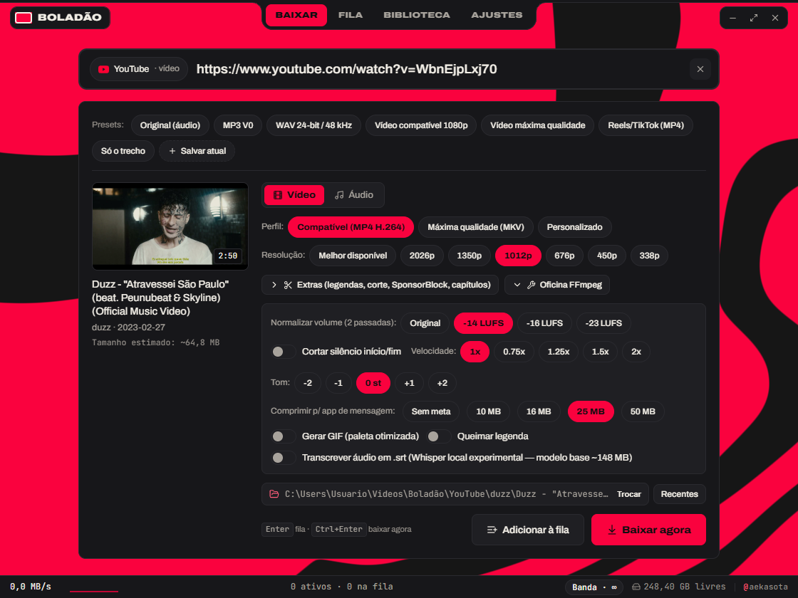
</div>

<br />

| Categoria | Ferramentas integradas | Detalhes técnicos |
|---|---|---|
| **Áudio & Masterização** | Normalização de volume (`-14`, `-16`, `-23 LUFS`) | `loudnorm` EBU R128 em **2 passadas** (`linear=true`, `TP=-1.0`, `LRA=11`) |
| **Conversão Lossless / DAW** | `WAV` (16/24/32-bit float), `AIFF`, `FLAC`, `ALAC` | Reamostragem **SoXR** (`precision=28`, 44,1/48/96 kHz) + dither `triangular_hp` ao reduzir para 16-bit |
| **Edição rápida de áudio** | Cortar silêncio, velocidade, pitch, mono/estéreo | `silenceremove` (início/fim), cadeia `atempo` e alteração de tom em semitons via **Rubberband** |
| **Vídeo & Compressão** | Comprimir para `10 / 16 / 25 / 50 MB`, escala, FPS | Compressão exata em **2 passadas** com margem de segurança de 3% e `+faststart` (pronto para Discord/WhatsApp) |
| **Aceleração por GPU** | H.264, HEVC (H.265) e AV1 | Detecta **NVENC**, **Intel QSV** e **AMD AMF** por teste real de `0,1 s`, com fallback automático para CPU (`libx264`/`libx265`/`libsvtav1`) |
| **GIF, Legendas & IA Local** | GIF animado, queimar legendas, frame PNG, Whisper | GIF em 2 etapas (`palettegen` + `paletteuse`), burn-in via `libass` e transcrição experimental `.srt` via filtro `whisper` do FFmpeg 9.0.2 |

---

### 3. Fila persistente, Limitador Global & Modo Jogo

<div align="center">
  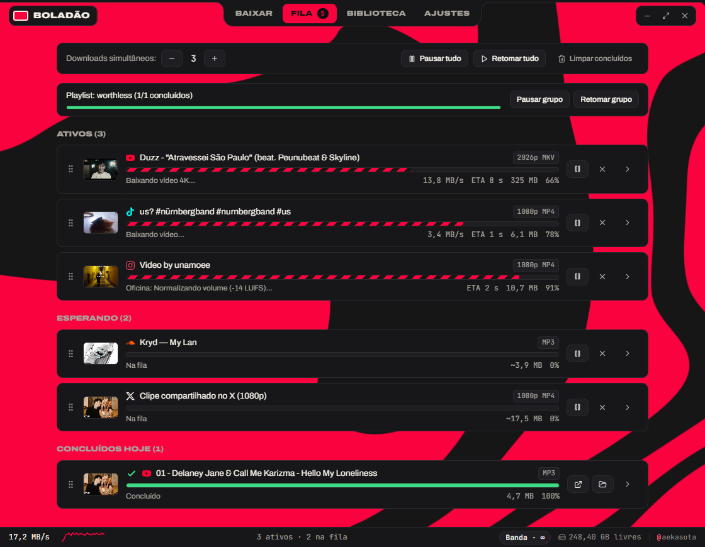
</div>

<br />

- **Fila persistente em SQLite (WAL)** — Feche o app ou reinicie o PC sem perder nada: arquivos `.part` são preservados e itens ativos voltam automaticamente para a fila ao reabrir.
- **Progresso real e monotônico** — Telemetria estruturada do `yt-dlp` (`BOLADAO_DL` / `BOLADAO_PP` / `BOLADAO_FILE`) e `-progress pipe:1` do FFmpeg garantem que a barra de progresso nunca dê saltos para trás ao trocar de stream de vídeo para áudio ou entrar na Oficina.
- **Controle fino e arraste nativo** — Ajuste downloads simultâneos (1–6) e limites por host, reordene itens arrastando, controle playlists em grupo e **arraste arquivos concluídos direto do Boladão** para o Windows Explorer, Premiere, DaVinci Resolve ou sua DAW.
- **Limitador global em tempo real (`< 1 s` de reação)** — Um proxy local em Rust (`127.0.0.1`) aplica um **Token Bucket** compartilhado entre todos os jobs simultâneos e ajusta `SO_RCVBUF = 256 KB` antes do `connect` para impedir bufferbloat do Windows. Troque entre **Sem limite (`∞`)**, **Equilibrado (60% do pico de 7 dias)**, **Leve (`2 MB/s`)** ou **Personalizado** (slider logarítmico exibindo `MB/s` e `Mbps` juntos) direto pela barra de status ou pela bandeja do sistema.
- **Modo Jogo automático** — Detecta jogos Direct3D em tela cheia (`SHQueryUserNotificationState`), janelas borderless em tela cheia ou executáveis da sua lista (`cs2.exe`, `valorant-win64-shipping.exe`, `eldenring.exe`, etc. — com seletor dos processos em execução). Quando ativo: limita banda, reduz concorrência para `1`, coloca encodes em `IDLE_PRIORITY_CLASS` e **congela o shader Op-Art (`0% GPU`)**, com histerese de 10 segundos ao sair do jogo.

<div align="center">
  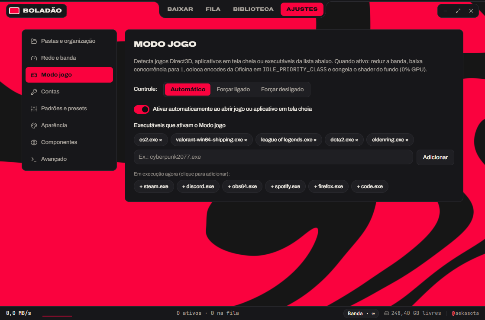
</div>

---

### 4. Biblioteca local com waveform, `ffprobe` e espectrograma

<div align="center">
  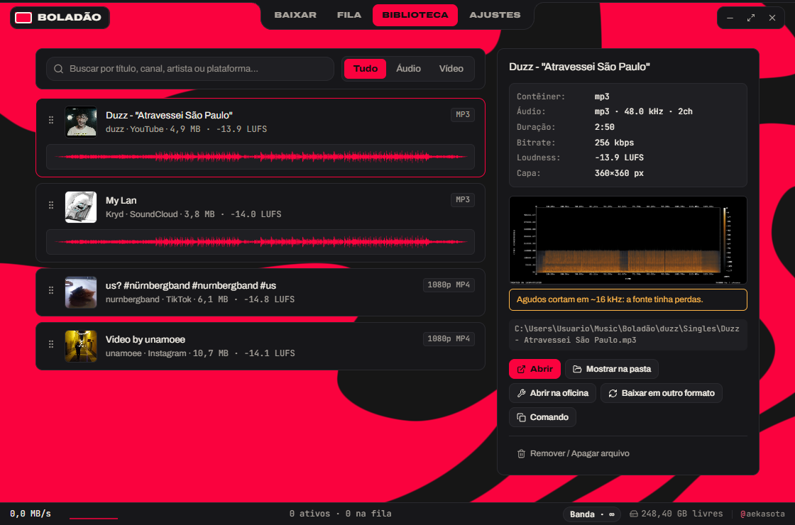
</div>

<br />

- **Catálogo local pesquisável** — Filtre por título, artista, canal, plataforma ou tipo (*Tudo / Áudio / Vídeo*).
- **Inspeção técnica automática** — Ao concluir cada download, o app registra contêiner, codecs de vídeo/áudio, resolução, FPS, taxa de amostragem, bits por amostra, bitrate, dimensões da capa embutida (`360×360`) e loudness integrado em **LUFS**.
- **Waveform & Espectrograma** — Áudios ganham forma de onda (`showwavespic`) automaticamente. Com um clique em *Ver espectrograma de qualidade*, o Boladão renderiza o espectrograma (`showspectrumpic`) e analisa a energia acima de `16,8 kHz` vs banda média para avisar honestamente se a fonte original tinha perdas (`~16 kHz`).
- **Ações diretas** — Abrir arquivo, revelar no Explorer, arrastar para outros apps, reprocessar na Oficina, baixar em outro formato ou copiar o comando `yt-dlp` equivalente.

---

### 5. Motores embutidos, atualização em 1 clique & Contas isoladas

<div align="center">
  
</div>

<br />

- **Atualização atômica do `yt-dlp` com rollback** — Escolha entre os canais **Stable** e **Nightly**. O app faz uma checagem semanal silenciosa no GitHub, baixa `yt-dlp_win.zip`, valida `SHA2-256SUMS` e preserva a versão anterior para **reverter com 1 clique** caso alguma atualização quebre um site.
- **Diagnóstico e catálogo de sites** — Rode `yt-dlp -v` pela interface para confirmar a integração `yt-dlp + Deno + FFmpeg` e pesquise nos **1.629 extratores** suportados.
- **Contas e cookies seguros** — Para conteúdos privados, Stories ou restritos por idade, abra uma janela WebView2 **totalmente isolada** (perfil separado e **zero permissões de IPC**) para Instagram, TikTok, X, Facebook, Twitch e Vimeo. Para YouTube, conecte cookies do **Firefox** (`--cookies-from-browser firefox`) ou importe um `cookies.txt` no formato Netscape.

---

## 🎨 4 Temas Op-Art (WCAG 2.1 AA)

O fundo é um **shader WebGL2 topográfico** escrito em GLSL que deforma suavemente com o movimento do cursor (física de mola amortecida), pulsa em ondas radiais ao concluir downloads, acelera o fluxo proporcionalmente à velocidade da rede (`log1p(MB/s)`) e reduz automaticamente a resolução interna se o frame time ultrapassar `12 ms` (ou cai para `15 fps` quando desfocado e `0% GPU` com *Reduzir movimento* ou *Modo Jogo*).

Todos os pares de texto/superfície e botões primários nos 4 temas passam por verificação matemática automatizada em `cargo test` garantindo contraste **WCAG 2.1 AA (`≥ 4,5:1`)**:

<table>
  <tr>
    <td width="50%" align="center">
      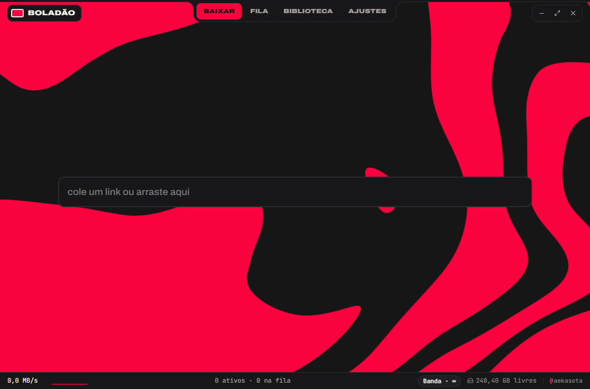
      <br />
      <strong>Sangue</strong> — <code>#FA023E</code> · <code>#161616</code>
    </td>
    <td width="50%" align="center">
      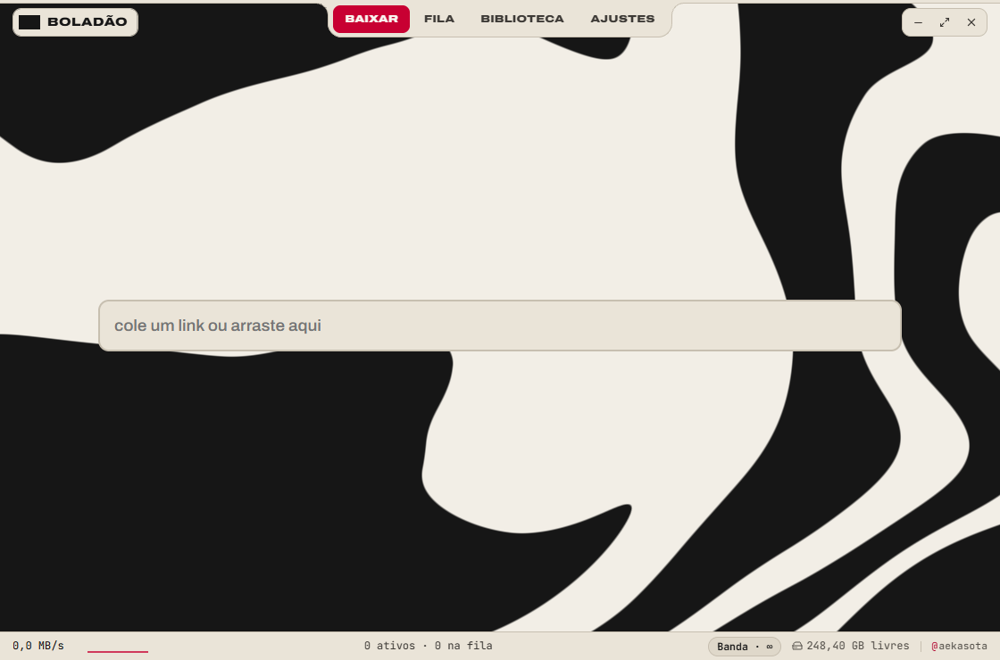
      <br />
      <strong>Papel</strong> — <code>#161616</code> · <code>#F2EEE6</code>
    </td>
  </tr>
  <tr>
    <td width="50%" align="center">
      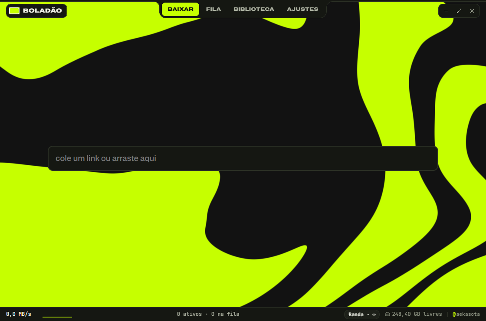
      <br />
      <strong>Ácido</strong> — <code>#C6FF00</code> · <code>#121212</code>
    </td>
    <td width="50%" align="center">
      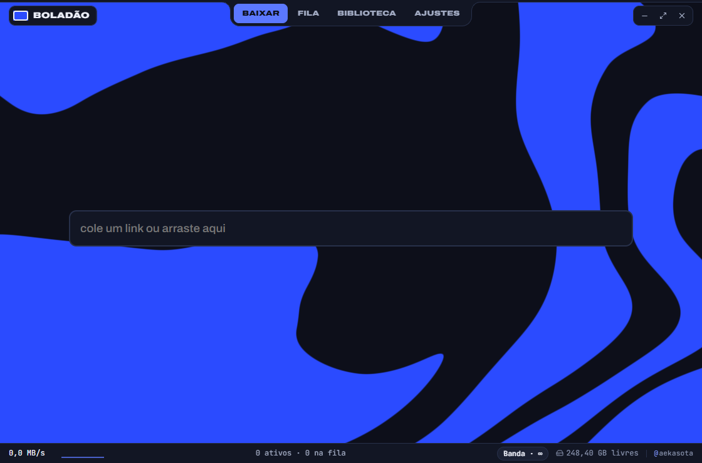
      <br />
      <strong>Cobalto</strong> — <code>#2B4BFF</code> · <code>#0D0F1A</code>
    </td>
  </tr>
</table>

---

## 📦 Como instalar (Usuários)

O instalador pronto para Windows é publicado exclusivamente na aba **[Releases](https://github.com/aekasota/BOLADAO/releases/latest)** para manter o repositório leve e limpo.

<div align="center">
  
</div>

<br />

1. Baixe o **`Boladao-Instalador.exe`** na página de **[Releases](https://github.com/aekasota/BOLADAO/releases/latest)**.
2. Execute o instalador gráfico nativo com visual Op-Art em português (não exige permissões de administrador).
3. Ele instala o app em `%LOCALAPPDATA%\Programs\Boladão`, cria atalhos opcionais no Menu Iniciar e na Área de Trabalho, registra nos *Aplicativos instalados* do Windows (com desinstalador próprio que **nunca apaga** suas músicas e vídeos), garante o Microsoft Edge WebView2 silenciosamente se ausente e já pré-extrai `yt-dlp`, `Deno` e `FFmpeg` prontos para uso imediato.

> [!NOTE]
> **Aviso do Windows SmartScreen:** por ser um projeto open-source sem certificado EV pago, o Windows Defender SmartScreen pode exibir *"O Windows protegeu o computador"* na primeira execução. Clique em **Mais informações → Executar assim mesmo**, ou compile diretamente do código-fonte seguindo o guia abaixo.

---

## ⌨️ Atalhos de teclado

| Atalho | Ação |
|---|---|
| `Ctrl + L` | Vai para **Baixar** e foca o campo de URL |
| `Ctrl + 1` · `2` · `3` · `4` | Alterna entre **Baixar**, **Fila**, **Biblioteca** e **Ajustes** |
| `Ctrl + ,` | Abre **Ajustes** |
| `Ctrl + V` (em qualquer tela) | Cola URL(s) direto no campo de download e inicia a sondagem |
| `Enter` | Adiciona o link atual à fila |
| `Ctrl + Enter` | **Baixar agora** (prioridade máxima no topo da fila) |
| `Ctrl + Shift + P` | Pausa todos os downloads |
| `Espaço` (na **Fila**) | Pausa ou retoma o item selecionado |
| `Delete` (na **Fila**) | Remove os itens selecionados |
| **Arrastar & Soltar** | Arraste links para dentro do app para baixar; arraste itens concluídos pela alça `⋮⋮` para fora (Explorer, Premiere, DAW) |

---

## 🛠️ Como rodar e compilar localmente

### Pré-requisitos (Windows 10/11 x64)

1. **[Rust](https://rustup.rs/)** estável (toolchain `stable-x86_64-pc-windows-msvc`) + **[Visual Studio Build Tools](https://visualstudio.microsoft.com/visual-cpp-build-tools/)** (carga *Desenvolvimento para desktop com C++*)
2. **[Node.js](https://nodejs.org/) 20+** e `npm`
3. **[Microsoft Edge WebView2 Runtime](https://developer.microsoft.com/en-us/microsoft-edge/webview2/)** (já incluso no Windows 11 e Windows 10 atualizados)

### 1. Clonar o repositório

```powershell
git clone https://github.com/aekasota/BOLADAO.git
cd BOLADAO
```

### 2. Baixar e verificar os binários externos (`yt-dlp`, `Deno`, `FFmpeg` e `WebView2`)

```powershell
powershell -ExecutionPolicy Bypass -File scripts/fetch-binaries.ps1
```

O script lê [`vendor/manifest.json`](vendor/manifest.json), confere os arquivos oficiais de checksum (`SHA2-256SUMS` / `.sha256sum`), valida o **SHA-256** de cada pacote, baixa o bootstrapper oficial do WebView2 e extrai tudo em `vendor/bin/` (pasta ignorada pelo Git). Na compilação do Rust, [`src-tauri/build.rs`](src-tauri/build.rs) empacota `yt-dlp`, `Deno` e `FFmpeg` em arquivos `.tar.zst` (zstd nível 19) embutidos diretamente no binário.

### 3. Instalar dependências do frontend

```powershell
npm install
```

### 4. Rodar em modo desenvolvimento (hot-reload)

```powershell
npm run tauri dev
```

> [!TIP]
> Para iterar apenas na interface web (com fallbacks locais sem compilar o backend Rust), você também pode usar `npm run dev`.

### 5. Rodar os testes automatizados e checagem de tipos

```powershell
# Checagem TypeScript + build de produção do frontend
npm run build

# 18 testes Rust: classificador, snapshots insta dos presets, progresso monotônico,
# sanitização de caminhos Windows, throughput real do limiter (20 MB a 2 MB/s),
# formato Netscape de cookies e contraste matemático WCAG 2.1 AA nos 4 temas
cd src-tauri
cargo test
```

### 6. Gerar o instalador nativo Op-Art (`instalador/Boladao-Instalador.exe`)

```powershell
npm run build:installer
```

Esse script compila o binário otimizado (`lto = "fat"`, `codegen-units = 1`, `strip = true`, `opt-level = 3`) e gera `instalador/Boladao-Instalador.exe` anexando o marcador de 16 bytes `BOLADAO_INSTALL!` ao final do executável — fazendo o próprio binário abrir em modo **Instalador Op-Art** (e, após instalado sem o marcador, atuar tanto como app quanto como desinstalador via `--uninstall`).

---

## 🏗️ Arquitetura e segurança

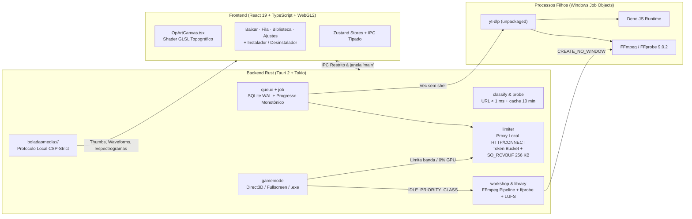

### Estrutura do projeto

```text
boladao/
├── src/                        # Frontend React 19 + TypeScript
│   ├── app/                    # Shell principal, notch arquitetural, atalhos e barra de status
│   ├── assets/fonts/           # Fontes variáveis auto-hospedadas (Archivo & JetBrains Mono)
│   ├── features/
│   │   ├── download/           # Palco Op-Art, sondagem ao vivo, presets, Extras e Oficina
│   │   ├── queue/              # Fila agrupada, reordenação, logs e arraste nativo
│   │   ├── library/            # Histórico SQLite, waveform, ffprobe, espectrograma e Oficina
│   │   ├── settings/           # Pastas, templates, rede, Modo Jogo, contas, temas e componentes
│   │   └── installer/          # Interface do instalador e desinstalador nativo Op-Art
│   ├── shader/                 # Shader GLSL WebGL2, física de mola e controle adaptativo de FPS
│   ├── stores/                 # Estado Zustand (app, queue, limiter, settings)
│   ├── theme/                  # Tokens CSS dos 4 temas WCAG AA e tipografia
│   └── ui/                     # Primitivos Radix UI + barras de progresso listradas Op-Art
├── src-tauri/                  # Backend nativo em Rust + Tauri 2
│   ├── build.rs                # Empacota yt-dlp, Deno e FFmpeg em .tar.zst (nível 19)
│   ├── capabilities/           # ACL estrita (IPC apenas na janela "main")
│   └── src/
│       ├── args/               # Construtor puro de flags yt-dlp + blocklist + snapshots insta
│       ├── bins/               # Extração atômica, probe de GPU/filtros, update e rollback yt-dlp
│       ├── classify/           # Classificador local (< 1 ms), dedup e bloqueio DRM
│       ├── cookies/            # Janelas WebView2 isoladas e exportação Netscape cookies.txt
│       ├── errors/             # Tradução de stderr para mensagens humanas em PT-BR com ação
│       ├── gamemode/           # Detecção Direct3D, tela cheia e lista de processos .exe
│       ├── installer/          # Modo instalador/desinstalador via marcador BOLADAO_INSTALL!
│       ├── ipc/                # Comandos Tauri tipados e drag-out nativo de arquivos
│       ├── job/                # Executor assíncrono e máquina de progresso monotônico
│       ├── library/            # Banco SQLite da Biblioteca, ffprobe, LUFS, waveform e cutoff 16 kHz
│       ├── limiter/            # Proxy local HTTP/CONNECT autenticado + Token Bucket compartilhado
│       ├── paths/              # Templates de pasta, sanitização Windows e proteção MAX_PATH
│       ├── probe/              # Sondagem única (-J --flat-playlist) com cache de 10 min
│       ├── queue/              # Agendador SQLite WAL, concorrência global/por host e retry
│       ├── spec/               # DownloadSpec, WorkshopSpec e os 7 presets nativos
│       ├── winproc/            # Windows Job Objects (KILL_ON_JOB_CLOSE) e CREATE_NO_WINDOW
│       └── workshop/           # Pipeline FFmpeg (loudnorm, SoXR, GPU encode, GIF, Whisper)
├── scripts/                    # Automação PowerShell (fetch-binaries, build-release, build-installer)
├── vendor/manifest.json        # Versões pinadas e hashes SHA-256 oficiais dos motores
└── docs/screenshots/           # Capturas de tela da interface final
```

### Garantias de engenharia e segurança

- **Zero invocação de shell** — Todos os processos (`yt-dlp`, `ffmpeg`, `ffprobe`, `deno`) são disparados diretamente via `Command::new` com `Vec<OsString>`, separador `--` antes da URL e flag `CREATE_NO_WINDOW` (nenhuma janela de console pisca).
- **Blocklist de flags perigosas** — Argumentos extras definidos pelo usuário passam por `validate_extra_args`, bloqueando `--exec`, `-o`, `--paths`, `--proxy`, `--netrc-cmd`, `--config-locations`, `--load-info-json`, `--plugin-dirs` e similares.
- **Zero processos órfãos** — Cada job roda dentro de um **Windows Job Object** configurado com `JOB_OBJECT_LIMIT_KILL_ON_JOB_CLOSE`. Cancelar ou encerrar o app termina instantaneamente toda a árvore de processos filhos.
- **CSP estrita e isolamento de IPC** — `src-tauri/capabilities/default.json` restringe todo IPC exclusivamente à janela `"main"`. Janelas de login (`"login-*"`) usam `data_directory` separado e **zero acesso ao backend**. Thumbnails, waveforms e espectrogramas são servidos pelo protocolo local `boladaomedia://` com bloqueio contra *path traversal*.
- **Proteção contra armadilhas do Windows** — Sanitização automática de nomes reservados (`CON`, `NUL`, `PRN`, `COM1`–`COM9`, `LPT1`–`LPT9`), `--windows-filenames`, `--trim-filenames` calculado dinamicamente pela profundidade da pasta para respeitar `MAX_PATH` e política configurável de colisão (*Manter os dois `(2)`*, *Substituir* ou *Pular*).

### Métricas medidas em Windows 10/11 x64

| Métrica | Resultado medido |
|---|---|
| **Tamanho do instalador (`Boladao-Instalador.exe`)** | **~132 MB** (perfil `lto = "fat"`, `strip = true`, `opt-level = 3`, motores em zstd nível 19) |
| **CPU parado (shader Op-Art 60 fps ativo)** | **0,00% – 0,03%** |
| **RAM (`Working Set` do processo Rust parado)** | **~42,8 MB** |
| **GPU com *Reduzir movimento*, *Modo Jogo* ou minimizado** | **0%** (render loop totalmente congelado) |
| **CPU com 3 downloads simultâneos sob Limiter (2 MB/s)** | **0,21%** no processo principal |
| **Processos órfãos ao cancelar ou encerrar abruptamente** | **0** (Windows Job Objects) |
| **Suíte automatizada (`cargo test`)** | **18/18 aprovados** (incluindo teste real de throughput do limiter e contraste WCAG AA) |

---

## ⚠️ Limitações conhecidas

- **Plataformas com DRM** — Spotify, Netflix, Disney+, Prime Video, Apple Music, Deezer e Tidal usam proteção DRM e não são suportadas pelo `yt-dlp`. O app identifica esses domínios localmente e avisa imediatamente.
- **Cookies do Chrome/Edge no Windows (v127+)** — O *App-Bound Encryption* do Windows impede a leitura externa de cookies do Chrome/Edge sem privilégios elevados. Para YouTube autenticado, utilize **Firefox** (`--cookies-from-browser firefox`) ou importe um `cookies.txt`; para Instagram, TikTok, X, Facebook, Twitch e Vimeo, use a janela WebView2 isolada integrada em *Ajustes → Contas*.
- **Transcrição Whisper local (experimental)** — Os modelos GGML (`base` ~148 MB ou `small` ~488 MB) não vão embutidos no executável para manter o binário enxuto; são baixados sob demanda na primeira vez em que a opção é ativada na Oficina.

---

## 📄 Licença e créditos

O código-fonte do **Boladão** é distribuído sob a licença **[MIT](LICENSE)**.

Os binários distribuídos nos **Releases** empacotam ferramentas open-source/oficiais de terceiros, baixadas diretamente de suas fontes oficiais com verificação SHA-256 durante o build:

| Componente | Versão pinada | Licença | Fonte oficial |
|---|---|---|---|
| **yt-dlp** | `2026.10.26` | Unlicense | [yt-dlp/yt-dlp](https://github.com/yt-dlp/yt-dlp) |
| **Deno** | `2.9.8` | MIT | [denoland/deno](https://github.com/denoland/deno) |
| **FFmpeg / FFprobe** (`full_build-shared`) | `9.0.2` | GPLv3 | [GyanD/codexffmpeg](https://github.com/GyanD/codexffmpeg) |
| **Microsoft Edge WebView2 Bootstrapper** | Evergreen | Termos Microsoft | [Microsoft WebView2](https://developer.microsoft.com/en-us/microsoft-edge/webview2/) |

> **Uso responsável:** o Boladão é uma ferramenta desktop de uso pessoal para arquivamento, estudo, acessibilidade e edição local de mídia. Respeite sempre os direitos autorais e os termos de uso das plataformas de onde você baixa conteúdo.
