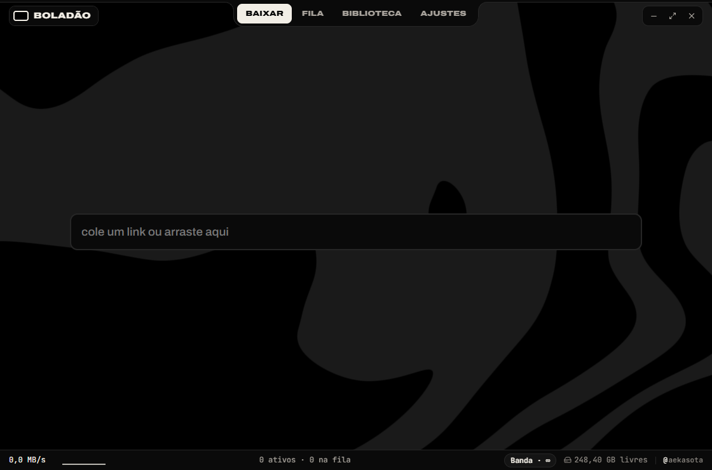
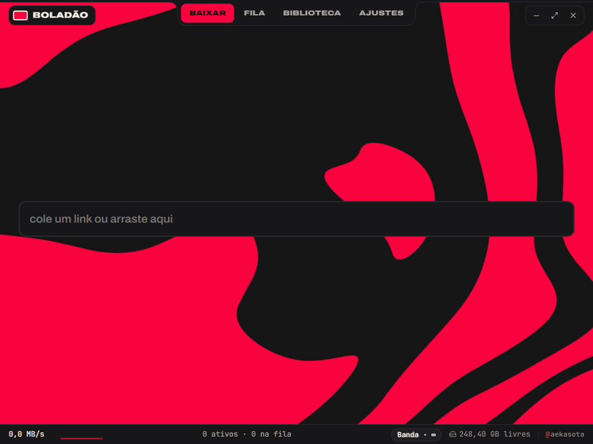
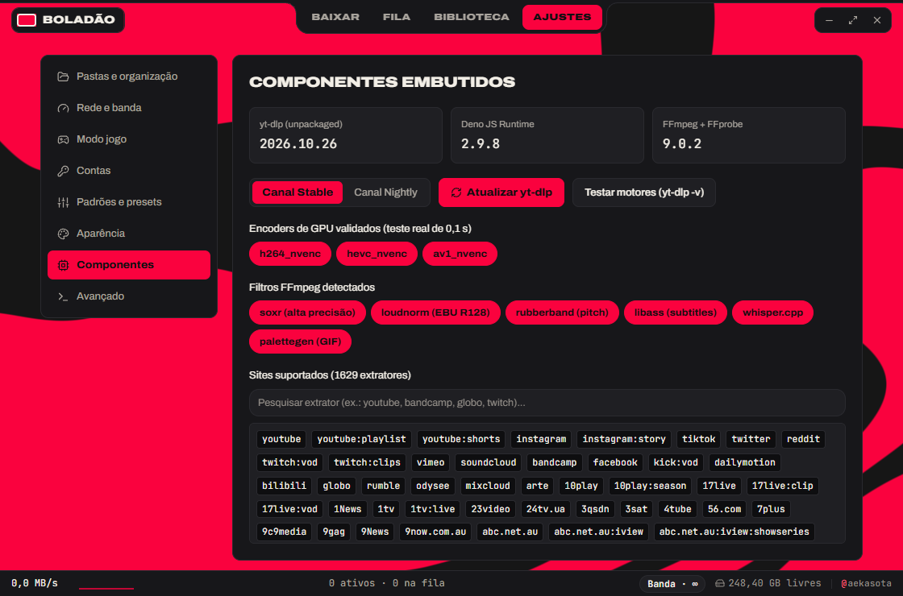
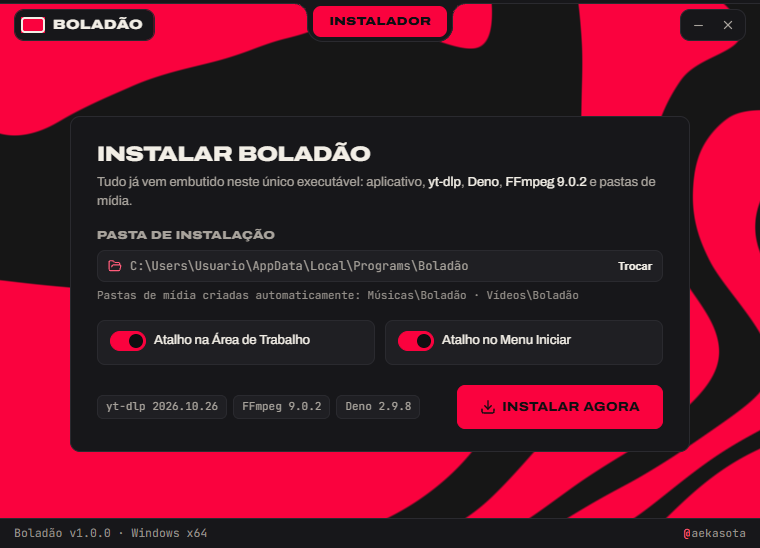
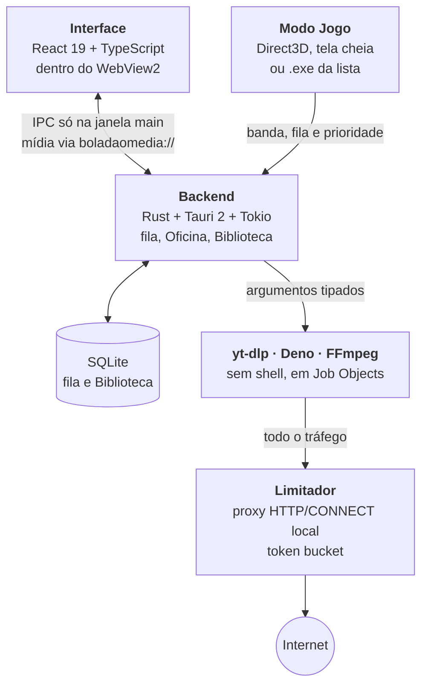

<div align="center">


# BOLADÃO

**Downloader de vídeo e áudio para Windows, com yt-dlp, Deno e FFmpeg embutidos em um único executável.**

Mais de 1.600 sites, fila persistente, Oficina FFmpeg, Modo Jogo e um fundo Op-Art em WebGL2 que reage ao cursor e à velocidade da rede.

<p>
  <a href="https://github.com/aekasota/BOLADAO/releases/latest"></a>
</p>

<p>
  
  
  
  <a href="LICENSE"></a>
</p>

<p>
  <a href="#como-instalar"><strong>Instalar</strong></a>
  &nbsp;·&nbsp;
  <a href="#design">Design</a>
  &nbsp;·&nbsp;
  <a href="#recursos">Recursos</a>
  &nbsp;·&nbsp;
  <a href="#como-funciona">Como funciona</a>
  &nbsp;·&nbsp;
  <a href="#rodar-localmente">Rodar localmente</a>
  &nbsp;·&nbsp;
  <a href="#arquitetura">Arquitetura</a>
</p>

<br />


<br />
<sub>Um vídeo do YouTube depois da sondagem: resoluções reais, tamanho estimado e o aviso de que 2026p só existe em VP9/AV1, com três saídas.</sub>

</div>

<br />

## Por que o Boladão

Baixar vídeo no Windows costuma ter duas saídas ruins: um site cheio de anúncios e pop-ups ou uma tarde configurando Python, `PATH`, `ffmpeg` e flags do yt-dlp no terminal.

O Boladão junta yt-dlp, FFmpeg e Deno em um aplicativo nativo. Você instala, cola um link e escolhe o formato. Tudo roda no seu computador, sem conta, sem anúncio e sem telemetria.

- **Nada para configurar.** yt-dlp `2026.10.26`, Deno `2.9.8` e FFmpeg `9.0.2` vêm comprimidos dentro do executável e são extraídos na primeira abertura. O próprio Boladão se atualiza sozinho, com a assinatura de cada versão conferida.
- **Download que não atrapalha o jogo.** Um limitador de banda único vale para todos os downloads ao mesmo tempo, inclusive HLS e DASH, e o Modo Jogo entra sozinho quando um jogo ocupa a tela.
- **Oficina FFmpeg.** Normaliza o volume em LUFS, converte para WAV 24-bit, comprime vídeo para caber no Discord ou no WhatsApp, gera GIF e transcreve áudio no próprio PC.
- **Fila persistente.** Fica salva em SQLite, tenta de novo quando a rede oscila e, se o app fechar no meio, continua cada download de onde parou.
- **Biblioteca com análise técnica.** `ffprobe`, loudness, forma de onda e um espectrograma que acusa quando a fonte já tinha perdas.
- **Transparente.** Avisa sobre DRM antes de tentar, explica cada erro em português com a ação para resolver e mostra o comando `yt-dlp` equivalente de cada download.

<br />

## Design

A identidade visual vem da Op-Art, a arte óptica dos anos 1960: duas cores chapadas, faixas de alto contraste e um fundo que parece se mover. O resto da interface fica quieto para não competir com ele. Os painéis são sólidos, com borda de 1 px e sem desfoque, transparência ou sombra.

<table>
  <tr>
    <td width="50%" align="center">
      
      <br />
      <strong>Sangue</strong> · padrão
    </td>
    <td width="50%" align="center">
      
      <br />
      <strong>Papel</strong> · claro
    </td>
  </tr>
  <tr>
    <td width="50%" align="center">
      
      <br />
      <strong>Ácido</strong> · escuro
    </td>
    <td width="50%" align="center">
      
      <br />
      <strong>Cobalto</strong> · escuro
    </td>
  </tr>
  <tr>
    <td colspan="2" align="center">
      
      <br />
      <strong>Breu</strong> · preto absoluto
    </td>
  </tr>
</table>

### O fundo

O fundo é um shader GLSL escrito à mão que roda em WebGL2. Ele gera um campo topográfico com ruído fBm distorcido (*domain warping*) e o corta em faixas na proporção 60/40, mais densas à direita da tela. As bordas são suavizadas com derivadas de tela (`fwidth`) e, onde as faixas ficariam mais finas que uns 2 px, as cores se misturam para não formar moiré.

Ele também reage ao que acontece no app:

| Quando | O fundo |
|---|---|
| o cursor se move | deforma as faixas como uma lente; a força segue uma mola amortecida e cresce com a velocidade do mouse |
| você clica numa área vazia | solta uma onda radial a partir do clique |
| um download termina | solta uma onda a partir do item concluído na fila |
| você arrasta um link sobre a janela | puxa as faixas na direção do campo de link |
| a velocidade da rede sobe | faz as faixas correrem mais rápido, em escala logarítmica (`log1p` dos MB/s) |
| você troca de tema | migra as cores em 600 ms |

Tudo isso custa pouco:

- desenha um único triângulo de tela cheia, sem buffer de vértices, com densidade de pixels limitada a 1,5×;
- se a média de 60 quadros passa de 12 ms, a resolução interna cai para 85% e, se ainda for preciso, para 70%;
- depois de 30 s sem foco, roda a 15 fps; com a janela minimizada, não desenha nada;
- com *Reduzir movimento*, com o Modo Jogo ativo ou com os efeitos de animação desligados no Windows, desenha um quadro estático e para (0% de GPU).

Em *Ajustes → Aparência* dá para trocar o tema e ajustar a intensidade do fundo (10% a 100%) e a densidade das faixas (0,70× a 1,40×).

### O logo é um furo

O retângulo ao lado do nome, no canto superior esquerdo, é um recorte de 24 × 16 px na pílula da marca. Por ele aparece o próprio shader, em contraste total, então o logo muda de cor com o tema e se mexe junto com o fundo. Repare nele nas capturas dos temas, logo acima.

### Notch, tipografia e movimento

- **Notch.** As abas ficam num notch que desce da borda superior da janela, com ombros côncavos de 14 px desenhados em SVG. A aba ativa é uma pílula que desliza entre as outras com uma mola (rigidez 420, amortecimento 34).
- **Janela própria.** Sem a moldura do Windows: o cabeçalho arrasta a janela, o clique duplo maximiza e os controles ficam em uma pílula à direita.
- **Tipografia.** Archivo variável (largura de 62% a 125%, peso de 100 a 900) no texto. Títulos e abas usam a largura máxima, peso 860 e caixa alta. Velocidades, tamanhos, tempos, caminhos e versões usam JetBrains Mono com algarismos tabulares, para que os números não tremam enquanto mudam. As duas fontes vão embutidas no app.
- **Progresso em listras.** As barras são listras diagonais nas cores do tema e correm mais rápido quanto maior a velocidade do download. Na pausa, elas param e ficam cinza; com erro, ficam âmbar; ao concluir, verdes. O carregamento e o seletor de temas usam as mesmas listras.
- **Barra de status.** Sempre visível: velocidade total com o gráfico dos últimos 60 s, itens ativos e na fila, o limite de banda (que abre o controle ao vivo) e o espaço livre no disco de destino.
- **Movimento.** Durações de 120, 200 e 320 ms com a mesma curva de saída, e molas para o que muda de lugar. *Reduzir movimento* congela o fundo, as listras e as transições das abas.

### Texto

A interface é toda em português do Brasil, com frases curtas e sem jargão. Quando o yt-dlp falha, o app traduz o erro e oferece uma saída:

| O yt-dlp responde | O Boladão mostra | E oferece |
|---|---|---|
| `Sign in to confirm you're not a bot` | O YouTube pediu login pra confirmar que você não é robô. | Conectar conta |
| `Requested format is not available` | Esse formato não existe pra essa mídia. | Ajustar opções |
| `Unable to extract …` | O site mudou e o yt-dlp precisa de atualização. | Atualizar yt-dlp e tentar de novo |
| `HTTP Error 429` | Muitas requisições. O app vai esperar e tentar de novo. | Nova tentativa automática |

O app também avisa quando uma escolha não ajuda. Ao converter para WAV, a tela explica: *"Converter Opus/AAC pra WAV/AIFF não melhora o som. Serve pra abrir em editor ou DAW."*

### Cinco temas

Quatro temas escuros e um claro. Cada um define o par de cores do fundo e o conjunto completo de tokens da interface (`--bg`, `--surface-1`, `--surface-2`, `--line`, `--text`, `--accent` e outros). A troca é instantânea, e as cores do shader migram em 600 ms.

| Tema | Cores do fundo | Destaque da interface | Menor contraste |
|---|---|---|---|
| Sangue | `#FA023E` e `#161616` | `#FA023E` | 4,72:1 |
| Papel | `#161616` e `#F2EEE6` | `#C80032` | 4,80:1 |
| Ácido | `#C6FF00` e `#121212` | `#C6FF00` | 5,48:1 |
| Cobalto | `#2B4BFF` e `#0D0F1A` | `#5B78FF` | 5,15:1 |
| Breu | `#000000` e `#1A1A1A` | `#F2EEE6` | 5,75:1 |

Um teste em `cargo test` confere esses números: ele calcula a razão de contraste WCAG 2.1 de 16 combinações por tema (cinco cores de texto sobre três superfícies, mais o botão principal) e falha se alguma ficar abaixo de 4,5:1. É por isso que o Cobalto usa um azul mais claro nos botões: o `#2B4BFF` do fundo não passaria no teste.

<br />

## Recursos

### Colar e sondar

Cole o link em qualquer tela do app com <kbd>Ctrl</kbd> + <kbd>V</kbd>, arraste-o para a janela ou aceite a sugestão que aparece por 6 s quando você volta ao app com um link copiado. O Boladão reconhece a plataforma na hora, sem acessar a rede, e faz uma única sondagem (`yt-dlp -J --flat-playlist`) para mostrar título, capa, duração, resoluções reais e tamanho estimado. O resultado fica 10 minutos em cache.

- **Plataformas com tratamento próprio:** YouTube e YouTube Music, Instagram (Reels, posts e Stories), TikTok, X, Reddit, Twitch (VODs, clipes e lives), Vimeo, SoundCloud, Bandcamp, Facebook, Kick, Dailymotion e Bilibili. Qualquer outro dos mais de 1.600 extratores do yt-dlp funciona pelo caminho genérico.
- **DRM avisado antes:** links do Spotify, Netflix, Disney+, Prime Video, Apple Music, Deezer e Tidal recebem um aviso direto, sem sondagem.
- **Vídeo dentro de playlist** (`watch?v=…&list=…`): o app pergunta se você quer só o vídeo (padrão) ou a playlist inteira.
- **Vários links de uma vez:** cole um trecho de conversa do WhatsApp ou do Discord e o app separa os links para baixar em lote.
- **Já baixado:** ao adicionar um link que já está na Biblioteca, o app avisa e pergunta se é para baixar de novo.

### Formatos, presets e extras

- **Sete presets nativos:** *Original (áudio)*, *MP3 V0*, *WAV 24-bit / 48 kHz*, *Vídeo compatível 1080p*, *Vídeo máxima qualidade*, *Reels/TikTok (MP4)* e *Só o trecho*. Os seus entram com *Salvar atual*, e a última escolha de cada plataforma fica guardada.
- **Áudio:** Original (sem reconversão), MP3 (V0 VBR ou 320 kbps CBR), M4A (AAC), Opus, FLAC, ALAC, WAV e AIFF. No WAV e no AIFF, você escolhe a profundidade (16 ou 24-bit, e 32-bit float no WAV) e a taxa (44,1, 48 ou 96 kHz).
- **Vídeo:** *Compatível* (MP4 H.264 + AAC), *Máxima qualidade* (MKV com AV1 ou VP9 e Opus, até 8K HDR, sem reconverter) ou *Personalizado* (MP4, MKV, WebM ou MOV, com o codec que você preferir).
- **Aviso de compatibilidade:** se você pede 4K em MP4 H.264 e essa resolução só existe em VP9 ou AV1, o app mostra a maior resolução H.264 disponível e oferece três saídas: usar essa resolução, manter a original em MKV ou recodificar para H.264 (na GPU, quando houver).
- **Extras:** legendas embutidas ou em `.srt` (inclusive as automáticas), capítulos embutidos ou divididos em arquivos, corte de trecho com controle duplo e corte preciso nos keyframes, SponsorBlock para remover ou marcar trechos (com um atalho para *Trecho sem música* em clipes), capa quadrada 1:1, separação de "Artista - Título" nos metadados e limpeza de sufixos como "(Official Video)".
- **Lives e estreias:** gravar a partir de agora, desde o início ou esperar a estreia começar. Quando o vídeo ainda não estreou, essa última opção já vem marcada.
- **Destino com prévia:** o caminho final aparece antes do download, montado a partir de modelos com 12 campos em português, como `{artista}\{album}\{faixa}` para áudio e `{plataforma}\{canal}\{titulo} [{id}]` para vídeo.

### Playlists

<div align="center">
  
</div>

- Escolha os itens um a um, marque ou desmarque todos de uma vez, ou aplique um intervalo (`Do #` / `Até #`).
- Ignore Shorts e lives, numere os arquivos (`01 - …`) ou junte tudo em um único arquivo (`--concat-playlist`).
- Os itens entram na fila como um grupo, com progresso próprio e botões para pausar e retomar o grupo inteiro.
- Em playlists com mais de 30 itens, o Boladão espaça as requisições do yt-dlp para evitar bloqueio por excesso de pedidos (HTTP 429).

<div align="center">
  
  <br />
  <sub>Colar a playlist, escolher MP3 V0, aplicar um intervalo e acompanhar o grupo na fila.</sub>
</div>

### Oficina FFmpeg

A Oficina aplica etapas de FFmpeg logo depois do download ou, mais tarde, a partir da Biblioteca (*Abrir na oficina*). O avanço vem do próprio FFmpeg (`-progress pipe:1`) e continua na mesma barra do download. Os encodes rodam com prioridade abaixo do normal e, durante o Modo Jogo, em `IDLE_PRIORITY_CLASS`.

<div align="center">
  
</div>

| Ferramenta | Opções | Como funciona |
|---|---|---|
| Normalizar volume | `-14`, `-16` ou `-23 LUFS` | `loudnorm` (EBU R128) em duas passadas: mede primeiro e aplica com `linear=true`, `TP=-1.0` e `LRA=11` |
| Cortar silêncio | início e fim | `silenceremove` com limiar de `-50 dB` nas duas pontas |
| Velocidade e tom | `0,75×` a `2×` · `-2` a `+2` semitons | cadeia de `atempo` · `rubberband` |
| Converter para edição | WAV, AIFF, FLAC e ALAC, pelo formato de áudio | reamostragem `soxr` (`precision=28`) e dither `triangular_hp` ao reduzir para 16-bit |
| Comprimir para mensageiro | `10`, `16`, `25` ou `50 MB` | H.264 em duas passadas mirando 97% do limite, com `+faststart` |
| GIF | 15 fps, 480 px de largura | `palettegen` + `paletteuse` com dither Bayer |
| Queimar legenda | legenda do próprio vídeo | filtro `subtitles` (libass) |
| Transcrever | `.srt` gerado no PC | filtro `whisper` do FFmpeg 9.0.2 com o modelo `base` (experimental) |
| Recodificar | H.264, pelo aviso de compatibilidade | NVENC, Quick Sync ou AMF, validados por um encode real de 0,1 s; sem GPU, `libx264` |

### Fila

A fila fica salva em SQLite. Pausar e retomar continua do ponto em que parou, e se o app fechar ou o PC desligar no meio, o que estava baixando volta para a fila na próxima abertura e continua de onde parou: os arquivos parciais em `.boladao-tmp` só são apagados quando nenhum item daquela pasta ainda pode usá-los.

<div align="center">
  
</div>

- De 1 a 6 downloads simultâneos (3 por padrão) e limite por site: YouTube 2, Instagram 1, TikTok 1 e 2 para os demais, ajustáveis em *Ajustes → Rede e banda*.
- <kbd>Ctrl</kbd> + <kbd>Enter</kbd> fura a fila (*Baixar agora*), e os itens em espera mudam de ordem quando você arrasta a alça ⋮⋮.
- A fila se divide em *Ativos*, *Falhas*, *Esperando* e *Concluídos hoje*, e cada playlist aparece como um grupo.
- Erros de rede, HTTP 429 e bloqueios temporários geram nova tentativa automática depois de 2 s, 8 s e 30 s.
- Cada item mostra as últimas 300 linhas do log do yt-dlp e permite copiar o comando equivalente, com a credencial do proxy local mascarada.
- Arraste um item concluído pela alça ⋮⋮ direto para o Explorer, o Premiere, o DaVinci Resolve ou a sua DAW.
- O ícone na barra de tarefas mostra o progresso médio. A notificação aparece quando a fila esvazia, agrupa downloads que terminaram juntos e fica em silêncio no Modo Jogo.
- Fechar a janela com downloads em andamento leva o app para a bandeja do sistema, onde dá para pausar, retomar e trocar o limite de banda.

### Banda e Modo Jogo

Todo o tráfego dos downloads passa por um proxy HTTP/CONNECT local, em `127.0.0.1`, com porta e credencial aleatórias a cada sessão. Ele aplica um *token bucket* compartilhado: o limite vale para a soma dos downloads, e não para cada um. O yt-dlp é obrigado a usar o downloader nativo em HLS e DASH, então esses fluxos também respeitam o limite.

- **Perfis:** *Sem limite*, *Equilibrado* (60% do maior pico já medido na sua conexão), *Leve* (2 MB/s) ou *Personalizado*, num controle logarítmico que mostra MB/s e Mbps juntos. A troca é feita na barra de status ou na bandeja e vale em menos de 1 s, mesmo no meio de um download (há teste para isso).
- **Limite preciso:** antes de conectar, cada socket recebe `SO_RCVBUF` de 256 KB, para o Windows não acumular megabytes em buffer, e as rajadas ficam limitadas a 125 ms de banda.
- **Plano B:** se o proxy não subir, o app usa `--limit-rate` e divide o limite entre os downloads.

<div align="center">
  
</div>

O **Modo Jogo** entra sozinho quando encontra um jogo Direct3D em tela cheia exclusiva (`SHQueryUserNotificationState`), uma janela sem borda cobrindo o monitor ou um executável da sua lista. A lista já vem com `cs2.exe`, `valorant-win64-shipping.exe`, `league of legends.exe`, `dota2.exe` e `eldenring.exe`, e os processos abertos aparecem como sugestão. A verificação roda a cada 2 s. Enquanto ele está ativo, por padrão:

- a banda cai para o perfil Leve (2 MB/s) e só um download roda por vez;
- os encodes da Oficina rodam em `IDLE_PRIORITY_CLASS`;
- as notificações ficam em silêncio;
- o fundo congela em um quadro estático (0% de GPU).

Ele sai 10 s depois que o jogo fecha, para não oscilar em telas de carregamento, e pode ser forçado a ficar ligado ou desligado.

### Biblioteca

<div align="center">
  
</div>

Todo download concluído entra na Biblioteca, com busca por título, canal, artista ou plataforma e filtro *Tudo*, *Áudio* ou *Vídeo*.

- Quando o download termina, o `ffprobe` registra contêiner, codecs, resolução, FPS, taxa de amostragem, bits por amostra, bitrate, duração e o tamanho da capa embutida.
- O loudness integrado é medido em LUFS (nos primeiros 180 s), e os áudios ganham forma de onda (`showwavespic`).
- *Ver espectrograma de qualidade* desenha o espectrograma (`showspectrumpic`) e compara a energia acima de 16,8 kHz com a faixa de 2 a 10 kHz. Quando os agudos somem num corte seco, o app avisa: *"Agudos cortam em ~16 kHz: a fonte tinha perdas."*
- Ações: abrir, mostrar na pasta, arrastar para outro programa, reprocessar na Oficina (normalização e corte de silêncio), baixar em outro formato, copiar o comando e remover da Biblioteca, com ou sem apagar o arquivo.

### Componentes e contas

<div align="center">
  
</div>

- **Motores à vista:** versões instaladas, encoders de GPU validados, filtros do FFmpeg detectados e busca entre os extratores do yt-dlp (1.629 na versão `2026.10.26`).
- **Atualização do yt-dlp:** uma vez por semana o app consulta o GitHub em silêncio e avisa quando sai versão nova, no canal *Stable* ou *Nightly*. A atualização baixa `yt-dlp_win.zip`, confere o hash em `SHA2-256SUMS`, troca a versão de forma atômica e guarda a anterior para voltar com um clique.
- **Diagnóstico:** *Testar motores* roda `yt-dlp -v` e mostra se yt-dlp, Deno e FFmpeg estão se entendendo.
- **Contas:** para conteúdo privado, restrito por idade ou Stories, o login acontece numa janela WebView2 isolada, com perfil próprio e nenhuma permissão de IPC, para Instagram, TikTok, X, Facebook, Twitch e Vimeo. No YouTube, a recomendação é usar os cookies do Firefox ou importar um `cookies.txt` (formato Netscape); a janela embutida também está disponível. Os cookies salvos ficam criptografados pela DPAPI do Windows, presos à sua conta de usuário, e só viram texto num arquivo temporário enquanto o yt-dlp roda.

<br />

## Como funciona

Do link colado ao arquivo na pasta:

1. **Classificação.** O link é analisado no próprio app: plataforma, tipo (vídeo, playlist, Reel, Story, live) e DRM, sem acessar a rede.
2. **Sondagem.** `yt-dlp -J --flat-playlist` traz metadados, formatos e itens de playlist. O resultado fica 10 minutos em cache; a capa é salva em disco e chega à interface pelo protocolo local `boladaomedia://`.
3. **Especificação.** As escolhas da tela viram um `DownloadSpec`. Uma função pura em Rust (`build_ytdlp_args`) transforma esse spec na lista de argumentos do yt-dlp, coberta por testes de snapshot.
4. **Fila.** O item é gravado no SQLite com prioridade, e o agendador respeita o limite global, o limite por site e o Modo Jogo.
5. **Download.** O yt-dlp roda sem shell, sem janela de console e dentro de um Job Object do Windows, com o tráfego passando pelo proxy de banda. O progresso chega em linhas JSON marcadas (`BOLADAO_DL`, `BOLADAO_PP`, `BOLADAO_FILE`) e vira uma porcentagem que nunca volta para trás, mesmo quando vídeo e áudio chegam em streams separados.
6. **Oficina.** Se houver etapas configuradas, o FFmpeg processa o arquivo e informa o avanço por `-progress pipe:1`.
7. **Biblioteca.** O arquivo final passa por `ffprobe`, loudness e forma de onda e entra na Biblioteca, enquanto o fundo pulsa a partir do item concluído.

Se algo falhar, o erro do yt-dlp vira uma mensagem em português com uma ação sugerida, e as falhas temporárias voltam para a fila sozinhas.

<br />

## Como instalar

<div align="center">
  
</div>

1. Baixe o **`Boladao-Instalador.exe`** (cerca de 132 MB) na [página de releases](https://github.com/aekasota/BOLADAO/releases/latest).
2. Abra o arquivo. O instalador não pede permissão de administrador.
3. Confira a pasta (o padrão é `%LOCALAPPDATA%\Programs\Boladão`), escolha os atalhos e clique em **Instalar agora**.

O instalador é o próprio Boladão em outro modo. Ele copia o app, cria as pastas `Músicas\Boladão` e `Vídeos\Boladão`, extrai os motores, cria os atalhos marcados e registra o app em *Aplicativos instalados*, com desinstalador próprio. Se o Microsoft Edge WebView2 não estiver presente, ele é instalado em silêncio antes de tudo.

**Atualização automática.** A partir da versão 1.1.0, o Boladão confere a última release do GitHub ao abrir e a cada 6 horas. Quando há versão nova, ele baixa o instalador em segundo plano, pelo limitador de banda (então respeita o Modo Jogo), confere a assinatura digital e mostra um aviso discreto. A atualização entra ao clicar em **Reiniciar agora** ou, sozinha, na próxima vez que o app abrir; downloads em andamento continuam de onde pararam. Quem está na 1.0.0 precisa instalar a 1.1.0 uma vez, à mão.

**Requisitos:** Windows 10 ou 11 de 64 bits e cerca de 500 MB livres (o app mais os motores extraídos).

> [!NOTE]
> **SmartScreen:** o executável não tem assinatura digital, então na primeira execução o Windows pode mostrar *"O Windows protegeu o computador"*. Clique em **Mais informações** e depois em **Executar assim mesmo**, ou compile a partir do código seguindo [Rodar localmente](#rodar-localmente).

Para desinstalar, abra *Configurações → Aplicativos*, encontre o Boladão e clique em **Desinstalar**. Suas músicas e vídeos nunca são apagados; uma opção extra remove também configurações, fila e cookies salvos.

<br />

## Atalhos de teclado

| Atalho | Ação |
|---|---|
| <kbd>Ctrl</kbd> + <kbd>L</kbd> | Vai para **Baixar** e foca o campo de link |
| <kbd>Ctrl</kbd> + <kbd>1</kbd> a <kbd>4</kbd> | Alterna entre **Baixar**, **Fila**, **Biblioteca** e **Ajustes** |
| <kbd>Ctrl</kbd> + <kbd>,</kbd> | Abre **Ajustes** |
| <kbd>Ctrl</kbd> + <kbd>V</kbd> | Fora de um campo de texto, cola o link em **Baixar** e começa a sondagem |
| <kbd>Enter</kbd> | No campo de link, adiciona à fila |
| <kbd>Ctrl</kbd> + <kbd>Enter</kbd> | No campo de link, **Baixar agora** (vai para o topo da fila) |
| <kbd>Ctrl</kbd> + <kbd>Shift</kbd> + <kbd>P</kbd> | Pausa todos os downloads |
| <kbd>Espaço</kbd> | Na **Fila**, pausa ou retoma o item selecionado |
| <kbd>Delete</kbd> | Na **Fila**, remove os itens selecionados |
| <kbd>Ctrl</kbd> + clique | Na **Fila**, seleciona vários itens |

Arrastar um link para a janela também inicia a sondagem, e a alça ⋮⋮ de um item concluído leva o arquivo para outro programa.

<br />

## Rodar localmente

### Pré-requisitos

| Ferramenta | Versão | Observação |
|---|---|---|
| Windows | 10 (versão 1803 ou mais nova) ou 11, x64 | `curl.exe` e PowerShell 5.1 já vêm com o sistema |
| [Rust](https://rustup.rs/) | estável, toolchain `stable-x86_64-pc-windows-msvc` | |
| [Visual Studio Build Tools](https://visualstudio.microsoft.com/pt-br/visual-cpp-build-tools/) | carga de trabalho *Desenvolvimento para desktop com C++* | fornece o linker do MSVC |
| [Node.js](https://nodejs.org/) | 20 ou mais novo, com npm | |
| [WebView2 Runtime](https://developer.microsoft.com/pt-br/microsoft-edge/webview2/) | Evergreen | já vem no Windows 11 e no Windows 10 atualizado |

Reserve espaço em disco: os motores baixados ocupam cerca de 525 MB (159 MB em `vendor/cache` e 366 MB em `vendor/bin`), e a pasta `src-tauri/target` pode passar de 10 GB com builds de debug e release.

### 1. Clonar o repositório

```powershell
git clone https://github.com/aekasota/BOLADAO.git
cd BOLADAO
```

### 2. Baixar os motores

```powershell
powershell -ExecutionPolicy Bypass -File scripts/fetch-binaries.ps1
```

O script lê [`vendor/manifest.json`](vendor/manifest.json), confere que o hash esperado de yt-dlp e Deno aparece nos arquivos de checksum oficiais (`SHA2-256SUMS` e `.sha256sum`), baixa os pacotes com `curl.exe`, valida o SHA-256 de cada um e extrai tudo em `vendor/bin/`, pasta ignorada pelo Git. Ele também baixa o bootstrapper oficial do WebView2, que vai embutido no instalador. Os arquivos ficam em cache em `vendor/cache/`; use `-Force` para baixar de novo.

> [!IMPORTANT]
> Rode este passo antes de qualquer `cargo` ou `npm run tauri`. O [`src-tauri/build.rs`](src-tauri/build.rs) empacota `vendor/bin` dentro do binário e interrompe a compilação se a pasta não existir.

### 3. Instalar as dependências do frontend

```powershell
npm install
```

### 4. Rodar em modo de desenvolvimento

```powershell
npm run tauri dev
```

O Tauri sobe o Vite em `http://localhost:1420` e abre o app com recarga a quente. A primeira compilação demora alguns minutos, porque o `build.rs` comprime yt-dlp, Deno e FFmpeg em `.tar.zst` com zstd nível 19, usando todos os núcleos. Nas seguintes, os arquivos comprimidos são reaproveitados enquanto versão, hash, quantidade e tamanho dos arquivos não mudarem.

> [!TIP]
> Para mexer só na interface, `npm run dev` abre o frontend no navegador em `http://localhost:1420`. Fora do Tauri, a camada de IPC ([`src/lib/ipc.ts`](src/lib/ipc.ts)) responde com dados locais: dá para navegar pelas abas e ver o shader, mas sondagem e downloads exigem o app desktop.

### 5. Verificar tipos e rodar os testes

```powershell
# Verificação do TypeScript (tsc) e build de produção do frontend
npm run build

# 27 testes em Rust
cd src-tauri
cargo test
```

Os testes cobrem:

- classificação de links, bloqueio de DRM e extração de vários links de um texto colado;
- argumentos gerados para cada preset (snapshots com [insta](https://insta.rs/)) e bloqueio de flags perigosas;
- progresso monotônico com streams separados e com HLS;
- sanitização de nomes e de caminhos longos do Windows;
- formato Netscape de cookies, comparação de versões do yt-dlp e leitura de formatos verticais de Reels e do X;
- contraste WCAG dos cinco temas;
- processos reais: o filho nasce dentro do Job Object, roda até o fim depois de retomado e morre quando o Job fecha;
- cookies: criptografia DPAPI de verdade, migração dos `.txt` antigos e devolução dos cookies renovados pelo yt-dlp;
- retomada: quais pastas temporárias podem ser limpas e a remoção restrita aos arquivos do item cancelado;
- atualização: comparação de versões, recusa de arquivo adulterado e troca do executável só com assinatura válida;
- o limitador de verdade: 20 MB a 2 MB/s em 10 s (±10%) e troca de limite no meio da transferência em menos de 1 s. Só esse teste leva uns 12 s.

### 6. Gerar o instalador

```powershell
npm run build:installer
```

| Arquivo gerado | O que é |
|---|---|
| `instalador\Boladao-Instalador.exe` | O instalador: o mesmo binário com o marcador `BOLADAO_INSTALL!` (16 bytes) no fim |
| `instalador\latest.json` | Versão, link e assinatura do instalador, lidos pela atualização automática |
| `dist\Boladao.exe` | O app avulso, que abre direto, sem instalar |

O script baixa os motores e roda `npm install` se faltar algo, compila com `tauri build --no-bundle` no perfil release (`lto = "fat"`, `codegen-units = 1`, `opt-level = 3`, `strip = true`, `panic = "abort"`) e grava os arquivos. Se encontrar a chave privada de atualização (padrão `%USERPROFILE%\.boladao\updater.key`, ou o caminho em `BOLADAO_UPDATER_KEY`), assina o instalador com `tauri signer sign` e gera o `latest.json`; sem a chave, o instalador sai normal, mas não serve como atualização. Para gerar só o executável avulso, use `scripts/build-release.ps1`.

### Publicar uma versão

1. Suba a versão em `package.json`, `src-tauri/Cargo.toml` e `src-tauri/tauri.conf.json`.
2. Rode `npm run build:installer`.
3. Crie a release com a tag `v<versão>` e anexe o instalador e o `latest.json`:

```powershell
gh release create v1.1.0 instalador/Boladao-Instalador.exe instalador/latest.json --title "Boladão v1.1.0" --notes-file notas.md
```

Os apps instalados leem `releases/latest/download/latest.json`, então só a release mais recente (fora de rascunho e pré-release) é oferecida.

> [!WARNING]
> A chave privada de atualização fica fora do repositório e não pode se perder: os apps instalados só aceitam atualizações assinadas por ela. Faça um backup de `%USERPROFILE%\.boladao\updater.key` em lugar seguro. Se ela vazar ou sumir, a troca de chave exige uma versão instalada à mão.

### Atualizar os motores embutidos

As versões ficam fixadas em `vendor/manifest.json`, com URL, arquivo de checksum e SHA-256 de cada pacote. Para trocar uma versão, edite a entrada, rode `scripts/fetch-binaries.ps1 -Force` e compile de novo: o `build.rs` percebe a mudança e reempacota. Isso muda a versão que vai no instalador; depois de instalado, o próprio app atualiza o yt-dlp em *Ajustes → Componentes*.

<details>
<summary><strong>Problemas comuns</strong></summary>

<br />

| Sintoma | Causa e solução |
|---|---|
| `Diretório vendor/bin/ytdlp não encontrado` ao compilar | Os motores não foram baixados. Rode `scripts/fetch-binaries.ps1`. |
| `SHA-256 inválido para ...` | O download veio diferente do esperado. Rode de novo com `-Force`; se persistir, confira `vendor/manifest.json`. |
| `Port 1420 is already in use` | Outro processo está usando a porta do Vite, que roda com `strictPort`. Encerre-o e rode de novo. |
| ``linker `link.exe` not found`` | Falta a carga *Desenvolvimento para desktop com C++* do Visual Studio Build Tools. |
| Erro de política de execução do PowerShell | Os comandos acima já usam `-ExecutionPolicy Bypass`, que vale só para aquele processo. |

</details>

<br />

## Arquitetura



A interface é React 19 com TypeScript, empacotada pelo Vite, com estado em Zustand e primitivos do Radix UI. O backend é Rust com Tauri 2 e Tokio: guarda fila e Biblioteca em SQLite (modo WAL), conversa com a interface por comandos tipados e eventos (`queue:changed`, `job:progress`, `limiter:stats` a 4 Hz, `gamemode:changed`) e entrega capas, formas de onda e espectrogramas pelo protocolo `boladaomedia://`.

### Um executável, três modos

O mesmo `boladao.exe` é app, instalador e desinstalador:

- Com o marcador `BOLADAO_INSTALL!` nos últimos 16 bytes (ou com `--installer`, ou com "instal" ou "setup" no nome do arquivo), ele abre o instalador.
- Ao instalar, ele se copia sem o marcador para a pasta de destino e passa a abrir como app.
- O registro em *Aplicativos instalados* chama `Boladão.exe --uninstall`. O desinstalador se copia para `%TEMP%` e se reabre de lá com `--uninstall-from-temp`, para conseguir apagar o executável instalado.

Os motores viajam dentro do binário. O `build.rs` comprime cada componente em um `.tar.zst` (os cerca de 363 MB viram 119 MB), e o código os inclui com `include_bytes!`. Na primeira abertura, eles são extraídos de forma atômica para `%LOCALAPPDATA%\Boladao\bin`, com a tela *Preparando os motores*. A configuração de bundle NSIS do `tauri.conf.json` fica desativada (`"active": false`): o instalador oficial é o próprio app.

### Garantias de segurança

- **Sem shell no caminho da mídia.** yt-dlp, FFmpeg, FFprobe e Deno são iniciados direto com `Command::new` e uma lista de `OsString`, com `--` antes da URL e a flag `CREATE_NO_WINDOW`. Só links `http://` e `https://` passam.
- **Flags perigosas bloqueadas.** Argumentos extras do usuário passam por `validate_extra_args`, que recusa `--exec`, `-o`/`--output`, `-P`/`--paths`, `--proxy`, `--ffmpeg-location`, `--js-runtimes`, `--netrc`, `--netrc-cmd`, `--netrc-location`, `-a`/`--batch-file`, `--config-locations`, `--load-info-json`, `--plugin-dirs`, `--print-to-file` e as variantes de `--write-*-link`.
- **Nenhum processo órfão.** Cada download roda num Job Object com `JOB_OBJECT_LIMIT_KILL_ON_JOB_CLOSE`: cancelar, pausar ou fechar o app encerra a árvore inteira de processos. O processo nasce suspenso e só é retomado depois de entrar no Job Object, então nem ele nem os processos que ele abre rodam fora do grupo. Se a associação falhar, o processo é encerrado e o download falha com erro, em vez de seguir solto.
- **Cookies criptografados.** Cookies de sessão valem como senha, então ficam guardados com a DPAPI do Windows, presos à sua conta de usuário. A cópia em texto que o yt-dlp exige existe só enquanto ele roda; os cookies que ele renova voltam criptografados, e cópias esquecidas por um fechamento abrupto são apagadas na abertura seguinte.
- **Atualizações assinadas.** O app só instala um executável cuja assinatura minisign confira com a chave pública embutida nele, e só de URLs das releases deste repositório. A assinatura é conferida no download e de novo antes de trocar o executável.
- **IPC isolado.** [`src-tauri/capabilities/default.json`](src-tauri/capabilities/default.json) libera comandos só para a janela `main`. As janelas de login (`login-*`) usam um diretório de dados próprio e não têm acesso nenhum ao backend.
- **CSP restrita.** Só scripts da própria origem rodam. O protocolo `boladaomedia://` serve apenas arquivos das pastas de cache e recusa `..`, `/` e `\` no nome do arquivo.
- **Proxy com credencial.** O proxy local só aceita a credencial aleatória da sessão, comparada em tempo constante, e o comando equivalente copiado vem com ela mascarada.
- **Nomes do Windows.** Nomes reservados (`CON`, `PRN`, `AUX`, `NUL`, `COM1` a `COM9`, `LPT1` a `LPT9`) recebem um prefixo, `--windows-filenames` fica sempre ligado e `--trim-filenames` é calculado pela profundidade da pasta para respeitar o `MAX_PATH`. Arquivos com o mesmo nome seguem a política escolhida: *Manter os dois (2)*, *Substituir* ou *Pular*.

### Onde ficam os dados

| O quê | Onde |
|---|---|
| App instalado | `%LOCALAPPDATA%\Programs\Boladão\Boladão.exe` |
| Músicas e vídeos (padrão) | `Músicas\Boladão` e `Vídeos\Boladão` |
| Configurações | `%APPDATA%\Boladao\settings.json` |
| Fila e Biblioteca | `%APPDATA%\Boladao\boladao.db` (SQLite) |
| Motores extraídos | `%LOCALAPPDATA%\Boladao\bin` |
| Capas, formas de onda e espectrogramas | `%LOCALAPPDATA%\Boladao\cache` |
| Cookies (criptografados) e perfis de login | `%LOCALAPPDATA%\Boladao\cookies` e `webview-profiles` |
| Atualização baixada, antes de instalar | `%LOCALAPPDATA%\Boladao\updates` |
| Modelo do Whisper | `%LOCALAPPDATA%\Boladao\models` |
| Arquivos temporários | `.boladao-tmp`, dentro da pasta de destino (no mesmo disco) |

<details>
<summary><strong>Estrutura do projeto</strong></summary>

<br />

```text
BOLADAO/
├── src/                        # Frontend: React 19 + TypeScript
│   ├── app/App.tsx             # Janela, notch, atalhos globais e barra de status
│   ├── features/
│   │   ├── download/           # Campo de link, sondagem, presets, extras e Oficina
│   │   ├── queue/              # Fila agrupada, reordenação, log e arraste para fora
│   │   ├── library/            # Biblioteca, detalhes do ffprobe e espectrograma
│   │   ├── settings/           # Pastas, rede, Modo Jogo, contas, presets, aparência e componentes
│   │   └── installer/          # Telas do instalador e do desinstalador
│   ├── lib/                    # IPC tipado (com respostas locais fora do Tauri) e formatação
│   ├── shader/                 # Shader GLSL, física do cursor e qualidade adaptativa
│   ├── stores/                 # Estado em Zustand (app, fila, limitador e ajustes)
│   ├── theme/tokens.css        # Tokens dos quatro temas, tipografia, notch e painéis
│   ├── ui/Primitives.tsx       # Botões, chips, toggles, slider e barra listrada
│   └── assets/fonts/           # Archivo e JetBrains Mono (variáveis, embutidas)
├── src-tauri/                  # Backend: Rust + Tauri 2
│   ├── build.rs                # Empacota os motores em .tar.zst (zstd 19)
│   ├── capabilities/           # Permissões de IPC (só a janela main)
│   ├── nsis/                   # Hooks do bundle NSIS (desativado)
│   └── src/
│       ├── args/               # Argumentos do yt-dlp, bloqueio de flags e snapshots
│       ├── bins/               # Extração, detecção de GPU e filtros, atualização do yt-dlp
│       ├── classify/           # Classificação local de links, dedup e DRM
│       ├── cookies/            # Janelas de login isoladas e cookies.txt (Netscape)
│       ├── errors/             # Tradução de erros para PT-BR com ação sugerida
│       ├── gamemode/           # Detecção de jogo (Direct3D, tela cheia e .exe)
│       ├── installer/          # Modos instalador e desinstalador
│       ├── ipc/                # Comandos Tauri e arraste nativo de arquivos
│       ├── job/                # Execução de um download e progresso monotônico
│       ├── library/            # Biblioteca, ffprobe, LUFS, forma de onda e corte em 16 kHz
│       ├── limiter/            # Proxy local HTTP/CONNECT e token bucket
│       ├── paths/              # Modelos de pasta, nomes do Windows e MAX_PATH
│       ├── probe/              # Sondagem com yt-dlp -J e cache
│       ├── queue/              # Agendador, prioridades, limites por site e novas tentativas
│       ├── spec/               # DownloadSpec, WorkshopSpec e presets nativos
│       ├── updater/            # Atualização automática pelas releases do GitHub (assinada)
│       ├── winproc/            # Job Objects, CREATE_NO_WINDOW e prioridade de processo
│       ├── workshop/           # Pipeline do FFmpeg
│       └── settings.rs         # Ajustes, gravação atômica e teste de contraste WCAG
├── scripts/                    # fetch-binaries, build-installer e build-release (PowerShell)
├── vendor/manifest.json        # Versões fixadas e SHA-256 dos motores
└── docs/screenshots/           # Capturas usadas neste README
```

</details>

<br />

## Desempenho

| Medida | Resultado |
|---|---|
| Tamanho do instalador | 132 MB, com `lto = "fat"` e motores em zstd nível 19 |
| CPU com o app parado e o shader a 60 fps | 0,00% a 0,03% |
| Memória com o app parado (*working set*) | ~42,8 MB |
| CPU com 3 downloads limitados a 2 MB/s | 0,21% |
| GPU com *Reduzir movimento*, Modo Jogo ou janela minimizada | 0%, porque o loop de renderização para |
| Processos órfãos depois de cancelar ou fechar à força | 0, graças aos Job Objects |
| `cargo test` | 27 de 27 aprovados |

<sub>Medições do autor no Windows 10/11 x64, no processo principal (<code>Boladão.exe</code>). O WebView2 roda em processos próprios do Windows, que não entram nesses números.</sub>

<br />

## Perguntas frequentes

<details>
<summary><strong>Funciona no macOS ou no Linux?</strong></summary>

<br />

Não. O Boladão é feito para Windows 10 e 11 (x64) e depende de recursos do sistema, como os Job Objects, a detecção de jogos em tela cheia e o WebView2.

</details>

<details>
<summary><strong>O app envia algum dado para fora?</strong></summary>

<br />

Não há telemetria. Fora os sites de onde você baixa (e as janelas de login, quando você as abre), o app só se conecta a:

- GitHub, para conferir e baixar versões novas do Boladão (ao abrir e a cada 6 horas), para a verificação semanal de versões do yt-dlp e para a atualização dele, quando você aceita;
- Hugging Face, para baixar o modelo do Whisper, se você ligar a transcrição;
- Microsoft, pelo instalador oficial do WebView2, se ele estiver faltando no sistema.

</details>

<details>
<summary><strong>Por que o instalador tem 132 MB?</strong></summary>

<br />

Porque yt-dlp, Deno e FFmpeg vão dentro dele: cerca de 363 MB de motores comprimidos em 119 MB. O app em si ocupa uns 12 MB. Em troca, não há nada para baixar ou configurar depois.

</details>

<details>
<summary><strong>Para que serve o Deno?</strong></summary>

<br />

O yt-dlp usa um runtime JavaScript externo para lidar com o JavaScript de alguns sites, como o YouTube. O Boladão embute o Deno e o entrega ao yt-dlp com `--js-runtimes`.

</details>

<details>
<summary><strong>Posso usar minha conta do YouTube?</strong></summary>

<br />

Pode, com cuidado. Usar uma conta logada com o yt-dlp pode levar a restrições nessa conta, então use só quando precisar (restrição de idade, conteúdo para membros) e, de preferência, com uma conta secundária. Prefira os cookies do Firefox ou um `cookies.txt`: no Chrome e no Edge (v127+), a criptografia *App-Bound* impede que outros programas leiam os cookies.

</details>

<br />

## Limitações conhecidas

- **DRM.** Spotify, Netflix, Disney+, Prime Video, Apple Music, Deezer e Tidal usam DRM e não são suportados pelo yt-dlp. O app reconhece esses links e avisa na hora.
- **Cookies do Chrome e do Edge.** A criptografia *App-Bound* desses navegadores (v127+) impede a leitura dos cookies por outros programas no Windows. Para o YouTube, use o Firefox ou um `cookies.txt`; para as outras plataformas, a janela de login em *Ajustes → Contas*.
- **Transcrição experimental.** O modelo `base` do Whisper (~148 MB) não vai no instalador. Ele é baixado do Hugging Face na primeira vez em que a transcrição roda.
- **Oficina parcial na interface.** O pipeline já aceita fade, mono/estéreo, escala, FPS, extração de quadro em PNG e recodificação em HEVC e AV1, mas esses controles ainda não estão na tela.

<br />

## Contribuindo

- **Bugs e ideias:** use os modelos de [bug](https://github.com/aekasota/BOLADAO/issues/new?template=bug_report.md) e de [melhoria](https://github.com/aekasota/BOLADAO/issues/new?template=feature_request.md). Em bugs de download, inclua o log do item (seta › à direita dele, na **Fila**) e a saída de *Ajustes → Componentes → Testar motores*.
- **Antes do pull request:** `npm run build` e `cargo test` precisam passar.
- **Texto da interface:** português do Brasil, no tom do app: frases curtas, sem jargão e com uma ação quando algo dá errado.
- **Cores:** só pelos tokens de [`src/theme/tokens.css`](src/theme/tokens.css). Ao mudar um tema, atualize também as cores do shader em [`src/shader/physics.ts`](src/shader/physics.ts) e a tabela do teste de contraste em [`src-tauri/src/settings.rs`](src-tauri/src/settings.rs), porque o teste não lê o CSS. Um tema novo entra ainda no `ThemeId` ([`src/lib/ipc.ts`](src/lib/ipc.ts) e `settings.rs`) e no seletor de [`SettingsTab.tsx`](src/features/settings/SettingsTab.tsx).
- **Argumentos do yt-dlp:** os snapshots em `src-tauri/src/args/snapshots/` acusam qualquer mudança. Revise com `cargo insta review` (instale com `cargo install cargo-insta`).

<br />

## Licença e créditos

O código do Boladão é distribuído sob a licença [MIT](LICENSE).

Os binários publicados em *Releases* incluem ferramentas de terceiros, baixadas das fontes oficiais e verificadas por SHA-256 durante o build. Cada uma segue a própria licença:

| Componente | Versão fixada | Licença | Origem |
|---|---|---|---|
| yt-dlp | `2026.10.26` | Unlicense | [yt-dlp/yt-dlp](https://github.com/yt-dlp/yt-dlp) |
| Deno | `2.9.8` | MIT | [denoland/deno](https://github.com/denoland/deno) |
| FFmpeg e FFprobe (`full_build-shared`) | `9.0.2` | GPLv3 | [GyanD/codexffmpeg](https://github.com/GyanD/codexffmpeg) |
| Bootstrapper do Microsoft Edge WebView2 | Evergreen | Termos da Microsoft | [Microsoft WebView2](https://developer.microsoft.com/pt-br/microsoft-edge/webview2/) |

As fontes [Archivo](https://github.com/Omnibus-Type/Archivo) e [JetBrains Mono](https://github.com/JetBrains/JetBrainsMono) vão embutidas no app e são distribuídas sob a SIL Open Font License 1.1.

> **Uso responsável:** o Boladão é uma ferramenta de uso pessoal para arquivar, estudar e editar mídia no seu computador. Respeite os direitos autorais e os termos de uso das plataformas de onde você baixa conteúdo.

<br />

<div align="center">
  <sub>Feito por <a href="https://github.com/aekasota">@aekasota</a> · Licença MIT</sub>
</div>
